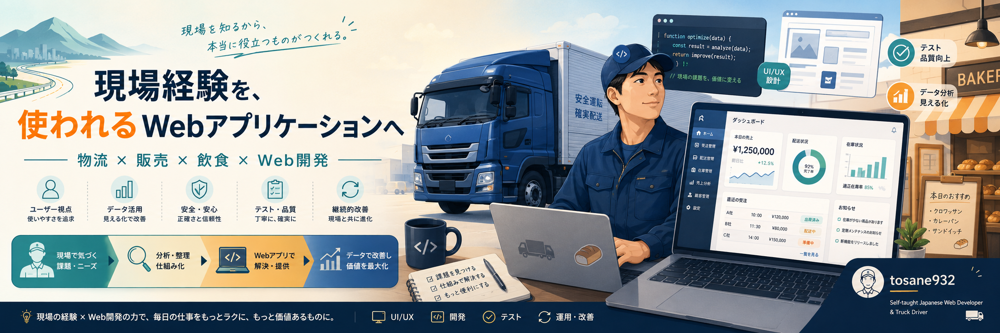

[Qiita](https://qiita.com/tosane932) ・ [Zenn](https://zenn.dev/tosane932) ・ [DEV Community](https://dev.to/tosane932)

# 🛠️ 現場経験を、使われるWebアプリケーションへ

IT業界での実務経験はありませんが、大型・中型トラックドライバーとして働きながら、2026年5月12日からPython / Flaskを中心にWebアプリケーション開発を学んでいます。AIを設計・調査・実装・検証の支援に使い、GitHub上の差分・テスト・実機で結果を確認しながら開発しています。

物流・飲食・販売の現場経験と、Webデザインで学んだ視線誘導・配色・情報設計を生かし、**利用者が迷わないUI、業務改善、ヒューマンエラー防止**につながる仕組みを考えています。実装して終わりではなく、第三者が実際に触れられる状態まで公開し、テストと実機確認を重ねることを大切にしています。

## 🚀 Tosane Works

**[Tosane Works](https://github.com/tosane932/tosane-works)** は、代表作品を分野別にまとめたポートフォリオリポジトリです。

- **[🥐 Bakery Hub — Store](https://github.com/tosane932/tosane-works/tree/main/store/bakery-hub)**: 商品・レジ会計・売上分析・スタッフ／シフト・仕込み・廃棄ロスを扱う店舗運営Webアプリ。v3.2 Guestの販売・返金・分析・店舗業務フローはコード実装・CI検証済み、**本番では未公開**。Admin正式レジも切替前です（[公開アプリ](https://bakery-salesdata.onrender.com/) / [システム概要](https://bakery-salesdata.onrender.com/system-overview)）。
- **[🕊 Puoppo — Information](https://github.com/tosane932/tosane-works/tree/main/information/puoppo)**: 公式RSSの記事を収集し、Gemini APIで要約・分析する情報収集Webアプリ（[Live Demo](https://puoppo.onrender.com/)）
- **[🚛 Driver Personality Test — Logistics](https://github.com/tosane932/tosane-works/tree/main/logistics/driver-personality-test)**: 物流現場の状況判断をもとに、安全運転の傾向を可視化する全50問の診断アプリ（[Live Demo](https://tosane932.github.io/tosane-works/logistics/driver-personality-test/)）

作品のスクリーンショット、技術構成、機能、設計判断は、Tosane Works内の各作品READMEへ集約しています。

## 🆕 最近の開発・検証（2026年10月〜11月2日）

- **店舗運営の整備**：ホーム、商品・写真管理、スタッフ／シフト、3ステップ仕込み、製造実績・廃棄ロスの記録を実装。ホームカードの押しやすさ、当日／週間天気、BakeryNewsの表示を改善。
- **写真タッチ式レジとPWA**：スマホは2列の商品一覧、横長タブレットは商品だけ横スクロール。Bakery Hub全体をインストール可能なPWAに対応し、レジの未同期会計は端末内キューと再送確認で保護。**Admin正式レジは本番切替前（NO-GO）**。
- **v3.2 Guest体験の開発**：PR [#153](https://github.com/tosane932/tosane-works/pull/153)〜[#159](https://github.com/tosane932/tosane-works/pull/159)で、Guestの商品登録・写真編集、会計保存・返金、日／週／月／年の売上分析、スタッフ／シフト、レシピ・製造予定を既存画面で扱えるようにしました。認可・Dataset分離・期限・上限を維持。**コードはmainにマージ済みですがGuest本番公開は未実施**。
- **認証・データ保護の検証**：Adminログアウト後のセッション失効を追加し、隔離PostgreSQLで異常系・rollback・競合を検証。通常起動時はDBのrevisionを確認し、自動migration・デモデータ投入を行わない構成へ整理。
- **テストと公開準備**：PR #159のGitHub Actionsでは **pytest 1,545 passed / 68 skipped、JavaScript 61 passed、Chromium E2E 78 passed**。PostgreSQL統合検証も成功。これは開発コードの検証結果であり、本番公開・全実機合格ではありません。2026年11月2日にはG580で本番DB暗号化取得・隔離復元・整合性検査を実施しました。

公開URLは既存運用版です。最新コードの公開は別工程で、Guest機能の有効化とAdmin正式レジ切替は独立して判断します。詳細は[Bakery Hub README](https://github.com/tosane932/tosane-works/blob/main/store/bakery-hub/README.md)と[Guest公開準備記録](https://github.com/tosane932/tosane-works/blob/main/store/bakery-hub/docs/v3.2-guest-launch-readiness.md)を参照してください。

なお、2026年10月初旬にはCodexとCosmic Rayで重複を除く1,286件のMutation監査を実施しました（KILLED 1,190 / SURVIVED 68 / ERROR 27 / EQUIVALENT 1）。[技術記事](https://qiita.com/tosane932/items/52dbc54dc2de3748bb72)に当時の結果を残しています。

## 🧰 Tech

- **Backend / Database**: Python, Flask, SQLAlchemy, Alembic, PostgreSQL, SQLite
- **Test / Delivery**: pytest, PostgreSQL統合テスト, Playwright / Chromium E2E, Mutation Testing（Cosmic Ray）, GitHub Actions, Docker, Gunicorn, Render
- **Frontend / API / Auth**: JavaScript, HTML, CSS, PWA, Gemini API, Flask-Login, Flask-WTF, Google OAuth（Puoppo）
- **Other**: Ruby on Rails 8, Git / GitHub

## 🎯 Development Philosophy

> **老若男女、誰が見ても使いやすいアプリ**

- 曖昧な文言を避け、現在の状態と次の操作を画面へ表示する
- 色だけに頼らず、アイコンと具体的な言葉を組み合わせる
- ヒューマンエラーを注意力だけに任せず、UI・入力検証・権限分離で防ぐ
- pytestとCIを段階的に拡充し、DB migrationやセキュリティの回帰確認に加えて、Mutation Testingでテストの検知力を検証する
- AIには作業範囲・禁止事項・停止条件を伝え、叩き台や調査に活用する。差分・影響範囲・テスト結果は人間が確認し、提案を無批判に採用しない
- 忙しい現場でも迷わず使えるかを実機で確かめ、実際に触れられる成果物として公開する

## 🚚 Background

- **大型・中型トラックドライバー（現役）**: 物流ドライバー歴8年。安全確認・危険予知・誤操作防止の視点を設計へ反映
- **百貨店催事**: 広島風お好み焼きの調理・実演販売、材料発注、売上管理、スタッフ採用・管理を経験
- **自動販売機補充**: 売上データをもとに、巡回ルート・積載量・商品構成・販促施策を設計
- **Webデザイン**: 視線誘導、配色、情報の優先順位をUI改善へ活用

業務を外から想像するのではなく、現場で迷ったこと、待ったこと、間違えやすかったことを、アプリの仕様へ落とし込むのが私の開発の出発点です。

## 📜 Qualifications

- ウェブデザイン技能士 3級
- 色彩検定 3級
- 情報処理技能検定（表計算）1級
- 日本語ワープロ検定 準1級
- MOS Excel 2007

## 💻 Development Environment

13年前のLenovo G580をSSD 256GB・メモリ16GBへ増強し、Lubuntu 24.04 LTSで開発しています。制約がある環境でも、原因を切り分けて代替案を試し、公開できるところまで進めています。

## ✍️ Writing

開発中に起きたエラー、原因、修正結果、再発防止策を、事実と推測を分けて記録しています。

- [Qiita：開発記録・エラー解決・検証結果](https://qiita.com/tosane932)
- [Zenn：開発の考え方・設計判断を伝える読み物](https://zenn.dev/tosane932)
- [DEV Community：英語での技術記事](https://dev.to/tosane932)

## 📅 Development History

<strong>主な開発履歴を見る</strong>

 

- **2026/05/12** — Pythonを中心としたWebアプリケーション開発の学習を開始
- **2026/05/23** — GitHubでソースコード管理を始め、Python / Flaskによる初期作品を公開
- **2026/06/02** — Ruby on Rails 8のWebアプリをRenderへ公開し、クラウド環境の制約と代替策を検証
- **2026/06/24〜07/04** — Bakery Hubのデータ保存をPostgreSQLへ移行し、Docker化・Render公開まで実施
- **2026/07/06** — Driver Personality Testを開発し、全50問・5段階配点・出題順のランダム化を実装
- **2026/07/11** — pytestとGitHub Actionsを導入し、継続的な回帰確認を開始
- **2026/07/17** — PuoppoへGoogle OAuthとFlask-Loginを導入
- **2026/08/02** — Codexによるリポジトリ全体の静的レビューを行い、保存型XSSを修正
- **2026/08/19〜08/24** — Bakery HubへDataset基盤とGuest権限分離を段階的に導入
- **2026/09/07** — 期限・利用制限・データ分離を備えたGuest Demoを一般公開
- **2026/09/13〜09/26** — 材料発注・店舗メモ・タスクを追加し、スマートフォンの長押し・並び替えUXまで改善
- **2026/09/28** — 代表3作品をTosane Worksへ統合し、分野別に見られるポートフォリオへ再構成
- **2026/09/30** — Tosane WorksにWeb Portfolioへの導線を追加。Bakery Hubのログイン画面から3分野の作品へアクセスできる入口を整備
- **2026/10/05** — Bakery Hubに公開「システム概要」を追加・拡充。処理フロー、理解度チェック、トラブル逆引きを実装
- **2026/10/06〜10/07** — 標準18種の商品テンプレート、商品履歴Catalog、Admin専用商品申請を実装（PR #79 / #80）
- **2026/10/03〜10/07** — Codex / Cosmic Rayで1,286件のMutationを再監査し、強化した正式pytestをmainへ反映（PR #81）
- **2026/10/08** — 開発・再監査の記録をQiita3記事として整理し、ポートフォリオのREADMEを更新
- **2026/10/10〜10/16** — Bakery Hubにスタッフ／シフト・仕込み管理・天気記録などの現場機能を追加・改善
- **2026/10/15〜10/16** — Bakery Hub v3.0の写真タッチレジ、商品管理、未同期会計対策、切替前監査を段階実装（PR #107〜#118。本番切替は未実施）
- **2026/10/18〜10/21** — レジのスマホ／タブレット表示、Bakery Hub全体のPWA、ホーム・週間天気・BakeryNewsを改善
- **2026/10/23〜10/30** — 製造実績・廃棄ロス記録、Adminセッションの失効管理と本番復旧を実施。正式レジはNO-GOを維持
- **2026/10/30〜11/01** — v3.2 Guestの商品管理→レジ会計→売上分析→スタッフ・シフト→仕込みを開発し、CI・隔離PostgreSQL・Chromiumで検証。公開は未実施（PR #153〜#160）
- **2026/11/02** — G580でPostgreSQL 18.6の暗号化バックアップ、独立DBへの実復元、参照整合性・制約検査を実施

詳しい変更履歴と設計判断は、[Tosane Works](https://github.com/tosane932/tosane-works)および[Qiita](https://qiita.com/tosane932)で公開しています。

